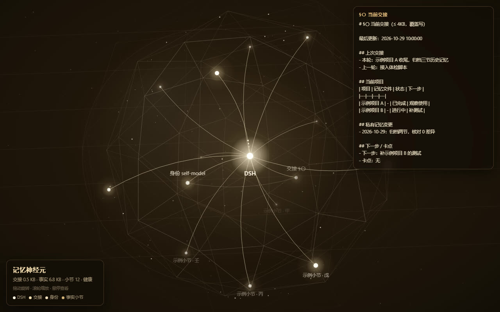

# 记忆神经元 · dsh-memory-neuron

> 让 AI 助手的记忆**活在文件里，而不是活在这次会话里**——一个侧栏入口、一颗会转的神经元球、七个能跑的命令。

[](https://github.com/x53310220040527081-blip/dsh-memory-neuron/releases)
[](LICENSE)
[](https://github.com/deepseek-ai)
[](#)



---

## 它解决什么问题

会话是有寿命的：上下文满了会被压缩，进程重启会丢状态，换一台机器就是陌生人。

普通的"记忆"做法是把聊天记录堆进提示词——越堆越胖，最后没人读。

这个插件换了一个前提：

> **一条会话的价值 = 它产出的文件，不是它聊了多少。**

于是"换会话"不再是灾难，**没写交接就换才是**。

## 三层记忆

| 层 | 文件 | 作用 | 红线 |
|---|---|---|---|
| **交接层** | `handoff.md` | §〇 当前交接：我是谁 / 干到哪 / 下一步 / 卡在哪，**覆盖写** | 4 KB |
| **事实层** | `memory.md` | 结论、命令、约定（可增长） | 12 KB |
| **身份层** | `self-model.md` | 我是谁、我的原则 | — |

配套：

- `archive/` —— 归档只进不改，每次搬迁自动**快照 + 逐行核对 0 差异**
- `audit/writes.jsonl` —— 每次写盘留痕

## 它能做什么

- **侧栏球体**：球笼（120 棱测地线）+ 光点节点，节点大小 = 该节体量；中心是 DSH，内环是交接与身份；拖动旋转、滚轮缩放、悬停查看。真实数据，30 秒刷新。
- **每轮注入**：把 §〇 交接注入系统提示词——**新会话开场就知道干到哪**，不用你说"读一下交接"。
- **七个命令**：交接 / 记一条 / 体检 / 归档 / 开工一屏 / 翻旧账 / 初始化。
- **翻旧账**：解压历史会话归档（多帧 zstd），按关键词搜出原话。

## 安装

```bash
# 方式一：GitHub 源（需要 git）
pnpm add github:x53310220040527081-blip/dsh-memory-neuron

# 方式二：release 里的 tarball（不需要 git，适合国内网络）
pnpm add https://gh-proxy.com/https://github.com/x53310220040527081-blip/dsh-memory-neuron/releases/download/v1.0.4/dsh-memory-neuron-1.0.4.tgz

# 方式三：本地目录
pnpm add file:E:\path\to\dsh-memory-neuron
```

> ⚠️ **必须在 DSH 自己的插件管理器里装**（设置 → 插件），不要手工改 `dsh.profile.bundles`——DSH 会在启动后重写它。

## 配置

`cordis.patch.yml`（或你自己的 patch 层覆盖）：

```yaml
- insert:
    - id: memory-neuron
      name: dsh-memory-neuron
      config:
        memoryRoot: 'C:\\Users\\<you>\\.dsh-memory'   # 记忆文件所在目录
        neuronDir: ''                          # 留空 = <memoryRoot>/neuron
        uiPort: 8318                           # 独立页面端口
        nodePath: ''                           # 留空 = 当前进程的 node
```

## 命令速查

```bash
node tools/memory.mjs status                 # 体量 / 健康 / 归档数
node tools/memory.mjs handoff --did "做了什么" --next "下一步"
node tools/memory.mjs remember "一条结论" --section 系统
node tools/memory.mjs check                  # 五小节 / 红线 / 重复事实
node tools/memory.mjs archive --section "系统现状"
node tools/memory.mjs recall                 # 打印"开工前一屏"
node tools/memory.mjs recall-session --q "关键词"
```

| 命令 | 约束 |
|---|---|
| `remember` | 单次 ≤10 行 / ≤2KB，超了直接拒绝 |
| `handoff` | 覆盖写，≤4KB，旧版自动归档 |
| `archive` | 快照 → 搬迁 → 逐行核对，不一致就回滚 |

## HTTP API（8318）

| 方法 | 路径 | 说明 |
|---|---|---|
| GET | `/` | 独立页面（球体 + 交接全文） |
| GET | `/api/state` | 交接 / 体量 / 小节明细 / 归档列表 |
| GET | `/api/recall` | 开工一屏 |
| POST | `/api/handoff` | 写交接 |
| POST | `/api/remember` | 记一条 |
| POST | `/api/check` | 体检 |
| POST | `/api/archive` | 归档一节 |
| POST | `/api/search` | 搜历史会话 |

## 目录结构

```
lib/host/index.js   宿主：建目录 / 起 8318 / 注入 §〇 / 调 memory.mjs
lib/host/ui.js      独立页面（内联 HTML/CSS/JS，零构建）
lib/client.js       侧栏入口 + 球体渲染（React）
cordis.patch.yml    bundle 补丁层
tools/memory.mjs    七个命令（CLI 独立可用）
tools/recall.py     历史会话检索（Python + zstandard）
```

## 踩过的坑（都已修，写在这里免得你也踩）

| 现象 | 原因 | 解法 |
|---|---|---|
| DSH 启动直接崩，报 `Missing services: clientModules` | 声明了 `dsh.client` 却没导出 `./client` | `package.json` 补 `"exports": { "./client": "./lib/client.js" }` |
| 侧栏页面一片空白 | 把对象当文本渲染 → `React error #31` | 数据结构变了要同步客户端 |
| 球笼画出来了但光点全无 | `snapRef` 只在挂载时赋值 | 数据更新时同步更新 ref |
| 插件加载 0.6 秒后被卸 | 端口被上一次的残留进程占着 | 端口冲突每 3 秒重试，最多 30 次 |
| 计划任务留个黑框，DSH 输出打在里面 | `-WindowStyle Hidden` 对 Windows Terminal 无效 | 用 VBS `WScript.Shell.Run(..., 0)` 启动 |

## 兼容与限制

- DSH **0.2.1-rc.3** 实测通过
- `recall-session` 需要 Python + `zstandard`（会话归档是多帧 zstd，Node 的 zlib 只能解第一帧）
- 8318 同机只能有一个实例在服务（插件会自动重试抢端口）
- 球体是 2D Canvas 透视投影，不是 WebGL——够用、无依赖、低功耗

## 更新日志

| 版本 | 内容 |
|---|---|
| **1.0.4** | 球体左移 + 背景透明 + 隐藏重启脚本 |
| 1.0.3 | 修 React #31 崩溃、修光点不渲染、侧栏换球体 |
| 1.0.2 | §〇 交接注入系统提示词（每轮自动带） |
| 1.0.1 | 修 `exports["./client"]` 缺失导致的启动崩溃 |
| 1.0.0 | 首个版本 |

## 致谢

记忆机制的设计来自 [淋雨家的工作台](https://github.com/mashanglinyu/luanyujia-workbench)：
交接 ≤4KB 覆盖写、只记结论不记过程、归档必须能证明没丢东西。这套纪律比我写的代码值钱。

## License

[MIT](LICENSE)
